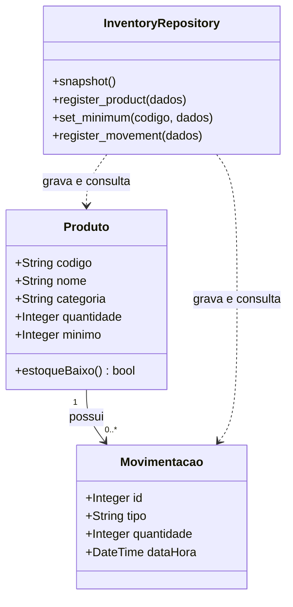
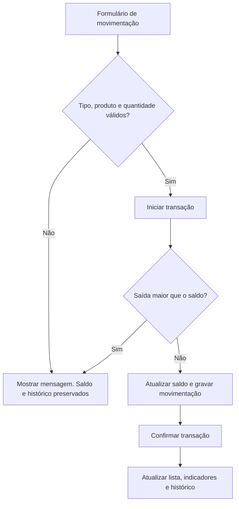

# Modelagem da aplicação

## Modelo atual (Sprint 8)

O banco guarda produtos e movimentações. O estoque mínimo é opcional. Entradas e saídas alteram o saldo e geram um registro no histórico na mesma transação. [Esquema SQL](../../src/backend/schema.sql)

`minimo` é opcional e `tipo` vale Entrada ou Saída. `estoqueBaixo()` é verdadeiro quando há mínimo configurado e a quantidade é igual ou menor que ele (RN-08).

## Modelos da Sprint 3

Os diagramas abaixo mostram como produtos e movimentações foram organizados na Sprint 3. As referências de código apontam para a versão daquela sprint.

### Fluxo de entrada

A entrada válida aumenta o saldo e aparece no histórico. Uma entrada inválida preserva os dados. Regras relacionadas: RN-02 e RN-03.

### Modelo de domínio

Um produto tem um saldo e pode ter várias movimentações.

## Relação com requisitos e código (Sprint 3)

| Requisito | Issue | Onde aparece |
|---|---|---|
| RF-01 e RF-02 | #1 e #2 | Cadastro e consulta de produtos no modelo de domínio. |
| RF-03 e RF-05 | #3 e #5 | Fluxo de entrada e consulta de movimentações. |
| RNF-05 e RNF-06 | #3 | Validação da entrada e persistência após recarregar. |

O [código da Sprint 3](https://github.com/WillianCustodio-lab/sistema-gerenciamento-estoque/blob/sprint-03/src/js/app.js) reúne os formulários e as classes `Product` e `Movement`. [Verificação do fluxo](evidencia-execucao.md)

## Limites da sprint

Nessa versão, o histórico apresentava entradas e os dados ficavam no navegador. As saídas chegaram na Sprint 4. A API e o banco passaram a ser usados na Sprint 6.
