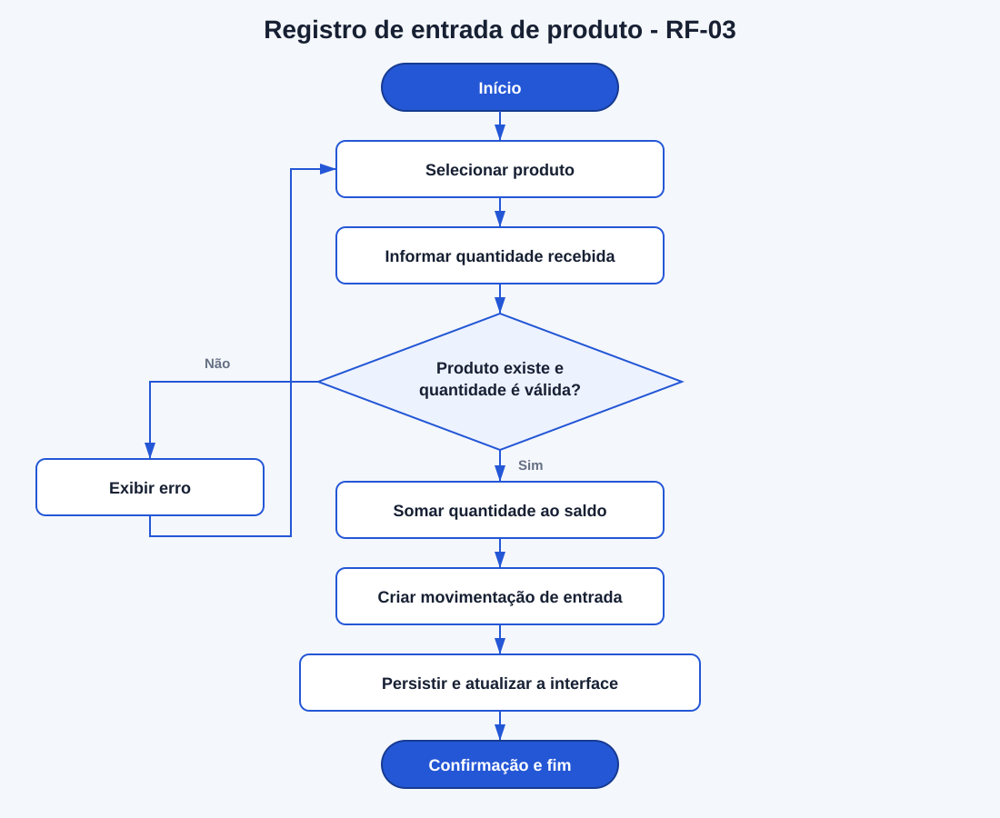
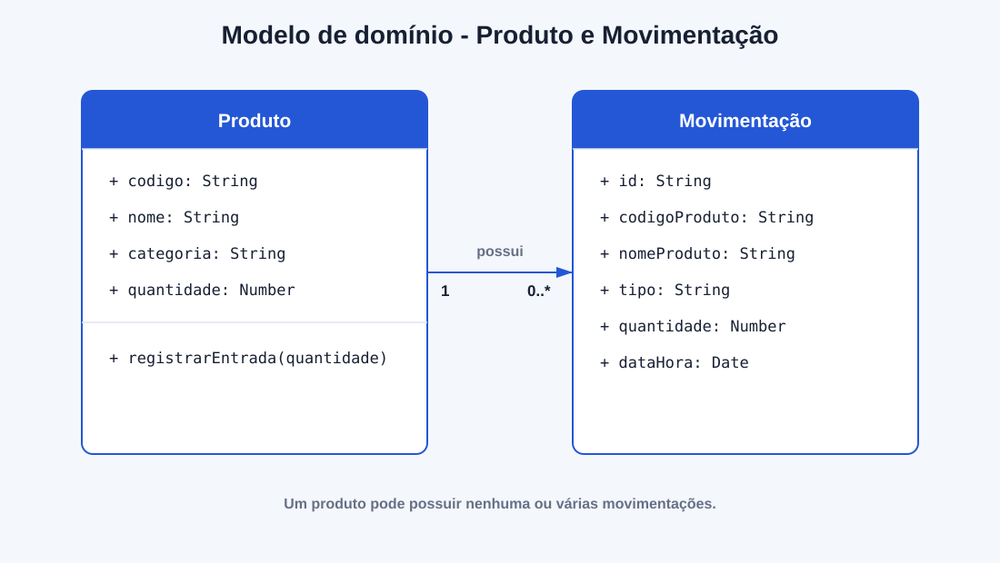

# Modelagem da aplicação

> **Artefato central da Sprint 3.** Os modelos representam a estrutura e o fluxo de registro de entrada implementado no Sistema de Gerenciamento de Estoque.

## 1. Escopo da modelagem

A modelagem considera o cadastro e a consulta de produtos já existentes e detalha o novo fluxo de registro de entradas. O objetivo é demonstrar como uma entrada válida atualiza a quantidade disponível e gera uma movimentação para consulta.

## 2. Modelo comportamental

### 2.1. Diagrama de atividades do registro de entrada

**Arquivo-fonte:** `imagens/fluxo-registro-entrada.mmd`

O fluxo começa com a seleção de um produto e a informação da quantidade recebida. O sistema valida os dados antes de alterar o estoque. Quando a entrada é válida, o saldo é atualizado, a movimentação é criada, os dados são persistidos e a interface apresenta a confirmação. Uma entrada inválida não altera o saldo nem o histórico.

O modelo representa `RF-03`, `RN-02`, `RN-03` e `RNF-05`.

## 3. Modelo estrutural

### 3.1. Modelo de domínio

**Arquivo-fonte:** `imagens/modelo-dominio.mmd`

O incremento utiliza duas estruturas principais:

- **Produto:** mantém código, nome, categoria e quantidade disponível. A operação `registrarEntrada` aumenta sua quantidade.
- **Movimentação:** registra o produto, o tipo da movimentação, a quantidade e a data e hora da operação.

Um produto pode possuir várias movimentações. No código, essas estruturas são representadas pelas classes `Product` e `Movement` em `src/js/app.js`.

## 4. Correspondência entre modelo e código

| Elemento modelado | Responsabilidade | Código correspondente |
|---|---|---|
| `Produto` | Manter os dados e atualizar o saldo. | Classe `Product` em `src/js/app.js`. |
| `Movimentação` | Registrar a entrada realizada. | Classe `Movement` em `src/js/app.js`. |
| Validação da entrada | Impedir produto inexistente ou quantidade inválida. | Tratamento do formulário `entry-form` em `src/js/app.js`. |
| Persistência | Manter produtos e movimentações após atualizar a página. | `localStorage` em `src/js/app.js`. |
| Interface do fluxo | Receber os dados e apresentar o resultado. | `src/index.html` e `src/css/styles.css`. |

## 5. Rastreabilidade

| Requisito | História/Issue | Modelo | Código | Evidência |
|---|---|---|---|---|
| `RF-01` | `US-01 / #1` | Entidade `Produto` | Cadastro em `src/js/app.js` | Produto incluído na consulta. |
| `RF-02` | `US-02 / #2` | Entidade `Produto` | Lista em `src/index.html` e `src/js/app.js` | Quantidade apresentada na tabela. |
| `RF-03` | `US-03 / #3` | Fluxo de entrada e entidades `Produto` e `Movimentação` | Formulário e processamento em `src/` | Saldo atualizado e entrada registrada no histórico. |
| `RF-05` | `US-05 / #5` | Entidade `Movimentação` | Histórico em `src/index.html` e `src/js/app.js` | Consulta parcial das entradas registradas. |
| `RNF-05` | `US-03 / #3` | Decisão de validação no fluxo | Validação anterior à persistência | Entrada inválida não altera os dados. |
| `RNF-06` | `US-03 / #3` | Persistência do fluxo | Chaves `estoque.produtos` e `estoque.movimentacoes` | Dados mantidos após atualizar a página. |

## 6. Decisões e limites

- A modelagem representa somente o incremento atual e não antecipa a arquitetura definitiva.
- O histórico desta sprint apresenta entradas. As saídas continuam planejadas para evolução posterior.
- A persistência local atende ao protótipo atual e poderá ser substituída quando a aplicação receber API e banco de dados.
