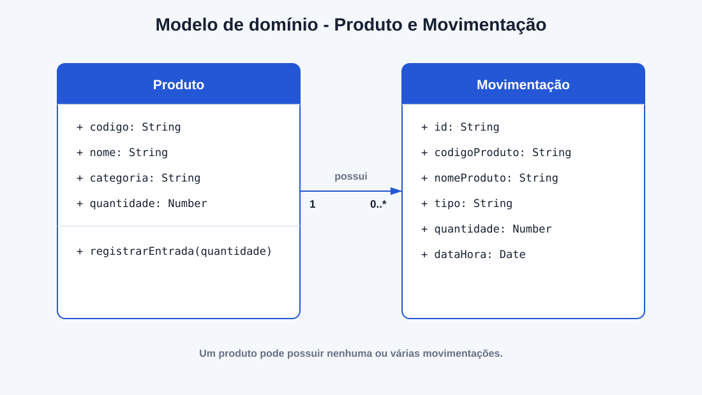

# Modelagem da aplicação

Os diagramas mostram como produtos e movimentações foram organizados na Sprint 3. As referências de código apontam para a versão daquela sprint.

## 2. Modelo comportamental

### 2.1. Diagrama de atividades do registro de entrada

**Arquivo-fonte:** `imagens/fluxo-registro-entrada.mmd`

O fluxo começa com a seleção de um produto e a informação da quantidade recebida. O sistema valida os dados antes de alterar o estoque. Quando a entrada é válida, o saldo é atualizado, a movimentação é criada, os dados são persistidos e a interface apresenta a confirmação. Uma entrada inválida não altera o saldo nem o histórico.

O modelo representa `RF-03`, `RN-02`, `RN-03` e `RNF-05`.

## 3. Modelo estrutural

### 3.1. Modelo de domínio

**Arquivo-fonte:** `imagens/modelo-dominio.mmd`

O incremento utiliza duas estruturas principais:

- **Produto:** mantém código, nome, categoria e quantidade disponível. A operação `registrarEntrada` aumenta sua quantidade.
- **Movimentação:** registra o produto, o tipo da movimentação, a quantidade e a data e hora da operação.

Um produto pode possuir várias movimentações. No código, essas estruturas são representadas pelas classes `Product` e `Movement` em `src/js/app.js`.

## Relação com requisitos e código

| Requisito | Issue | Onde aparece |
|---|---|---|
| RF-01 e RF-02 | #1 e #2 | Cadastro e consulta de produtos no modelo de domínio. |
| RF-03 e RF-05 | #3 e #5 | Fluxo de entrada e consulta de movimentações. |
| RNF-05 e RNF-06 | #3 | Validação da entrada e persistência após recarregar. |

O [código da Sprint 3](https://github.com/WillianCustodio-lab/sistema-gerenciamento-estoque/blob/sprint-03/src/js/app.js) reúne os formulários, as classes `Product` e `Movement` e a persistência. Os resultados estão na [verificação do fluxo](evidencia-execucao.md).

## Limites da sprint

Nessa versão, o histórico apresentava entradas e os dados ficavam no navegador. As saídas chegaram na Sprint 4. A API e o banco passaram a ser usados na Sprint 6.
